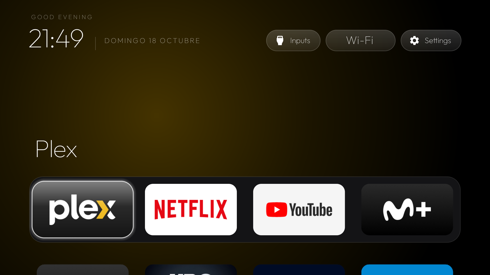

# Simple ATV Launcher

A minimal, tvOS-flavoured home screen for Android TV / Google TV boxes and sets — black canvas,
a pinned dock, a top shelf with the focused app's name, one glass highlight that glides between
tiles, a large clock, and a clock screensaver. Fork of
[Gathin23/tv-vibehack](https://github.com/Gathin23/tv-vibehack) (MIT) with a built-in layout
**arrange mode**.



## Features

- **Dock** of up to `columns` apps, **top shelf** showing the focused app's name with an ambient
  glow sampled from its artwork.
- **One floating glass highlight** that springs between tiles; the row scroll animates with it.
- **Greeting, large thin clock, date** (Outfit typeface), Wi-Fi pill showing the connected network.
- **Arrange mode** — reorder everything and pick what lives in the dock, on the TV itself.
- **Clock screensaver** (optional) that drifts to avoid burn-in.
- No network code, no analytics: the APK requests only network-state / Wi-Fi-state / fine-location
  (the last one solely to read the SSID for the Wi-Fi pill).

## Arrange mode

Hold **OK** on any tile:

| Key | Action |
|---|---|
| ◀ ▶ | move the tile within its row |
| ▲ ▼ | move the tile one row up/down — **moving up into the dock makes it a dock app**, moving down pulls it out into the grid |
| OK | save (dock membership + dock order + grid order) |
| Back | cancel |

While arranging, a long press still opens the Android App Info screen (the stock behaviour).
The layout is stored in the app's `SharedPreferences` (`dock/order_v1`) and survives reboots and
`pm install -r` updates. Reset to the compiled defaults with `pm clear com.gathin.tvhome`
(then re-grant the location permission, see below).

## Build

Needs JDK 17 and Android SDK platform 34 + build-tools 34.0.0.

```bash
./gradlew assembleDebug
# app/build/outputs/apk/debug/app-debug.apk
```

Or let GitHub Actions build it: every push to `main` produces an `app-debug` APK artifact.

## Install on the TV

```bash
adb connect <tv-ip>:5555            # accept the "Allow USB debugging" dialog on the TV
adb install -r app/build/outputs/apk/debug/app-debug.apk
adb shell pm grant com.gathin.tvhome android.permission.ACCESS_FINE_LOCATION
adb shell cmd package set-home-activity --user 0 com.gathin.tvhome/.MainActivity
adb shell pm disable-user --user 0 com.google.android.tvlauncher   # once the new home is verified
```

`build-and-install.sh` wraps this (`TV_HOST=<ip> ./build-and-install.sh`). Keep the stock launcher
enabled until the new home has been verified across a reboot; it is the way back in if anything
goes wrong (`pm enable com.google.android.tvlauncher`).

## Configuration

`app/src/main/res/values/config.xml` holds the factory defaults: `dock_apps` (order), the apps
never shown (`hidden_apps`), the Live TV package, and `columns` (dock slots = grid columns).
Once a layout has been saved with arrange mode, that saved order wins over `dock_apps`.

The package id stays `com.gathin.tvhome` on purpose, so this fork installs over the upstream build
(`pm install -r`) and keeps an existing layout.

## Differences from upstream

- Arrange mode (dock + grid, choose dock apps, persisted order) — upstream has only the compiled
  `dock_apps` list.
- Highlight animation fixes for vertical moves: the glass is given the exact post-scroll position
  (or rides the scroll rigidly when the target is off-screen) instead of chasing a target that is
  still moving, which removed the rubber-band wobble on ▲▼.
- Key-long-press path (`FLAG_LONG_PRESS`) wired as well as the View timer, so held-OK works on
  remotes/ROMs that deliver the flag.

## Licence

MIT — see `LICENSE` (© 2026 Gathin, upstream). The bundled **Outfit** typeface is under the SIL
Open Font License, see `FONT-LICENSE-OFL.txt`. Modifications in this fork are released under the
same MIT terms.
